# Directorio Dolorense

Aplicación móvil en **Flutter** que consume una **API REST local hecha con Node.js** para mostrar, agregar, marcar como favoritos y eliminar negocios de Dolores Hidalgo. Incluye pruebas automáticas (`flutter test`) con un cliente HTTP simulado (`MockClient`).

---

## Estructura del proyecto

```
directorio_dolores/
├── api/                      API en Node.js (sin dependencias externas)
│   └── server.js
├── app/                      App Flutter
│   ├── lib/
│   │   ├── dominio/          Modelo (negocio.dart) y excepciones
│   │   ├── datos/            Cliente HTTP (negocios_api.dart)
│   │   ├── presentacion/     ViewModel y pantalla
│   │   └── main.dart
│   ├── test/                 Pruebas automáticas
│   └── pubspec.yaml
├── evidencias/               Capturas de pantalla
└── README.md
```

## Requisitos

- Node.js
- Flutter y el SDK de Android
- Emulador Android (se usó **LDPlayer**) con la depuración ADB activada

## Cómo ejecutarlo

### 1. Encender la API

```
cd api
node server.js
```

Debe mostrar `API lista en http://localhost:3000/negocios`.

### 2. Configurar la dirección de la API en la app

El emulador no entiende `localhost` de la computadora, así que en `app/lib/main.dart` se usa la IP de la PC en la red:

```dart
const urlApi = 'http://TU_IP:3000';
```

Para conocer la IP, ejecuta `ipconfig` y copia la **Dirección IPv4** del Wi-Fi. Si cambias de red, hay que actualizarla.

### 3. Correr la app

```
cd app
flutter pub get
flutter run
```

### 4. Correr las pruebas

```
cd app
flutter test --reporter expanded
```

---

## Evidencias

### Aplicacion en funcionamiento

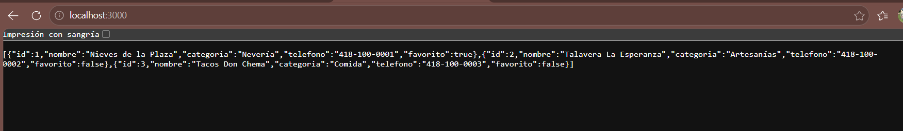
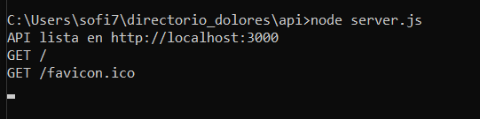
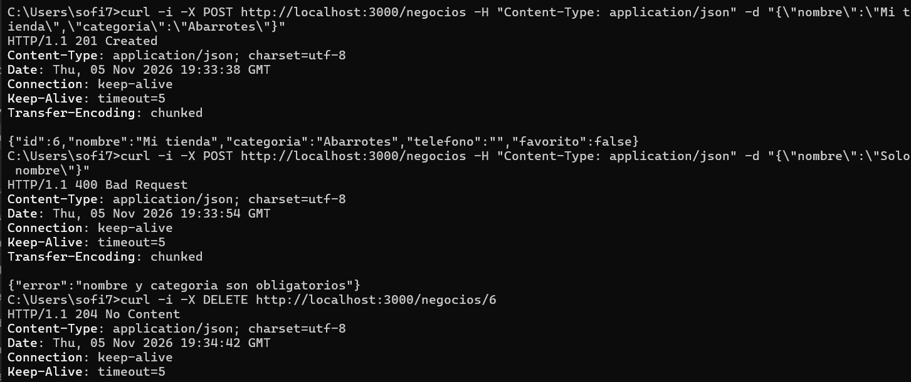
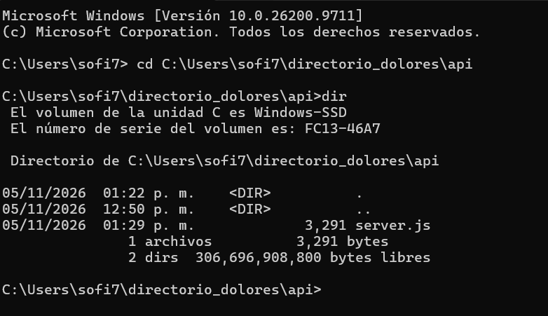
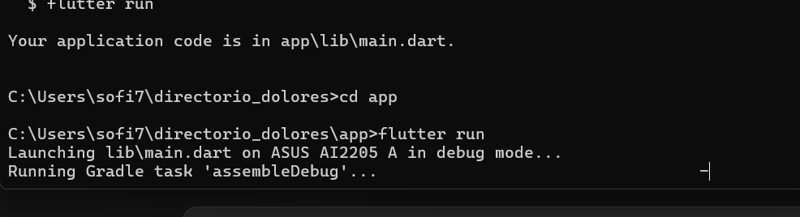
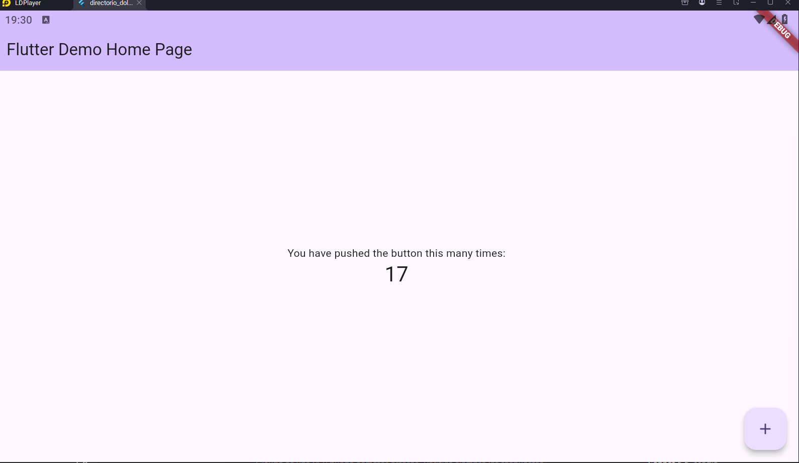
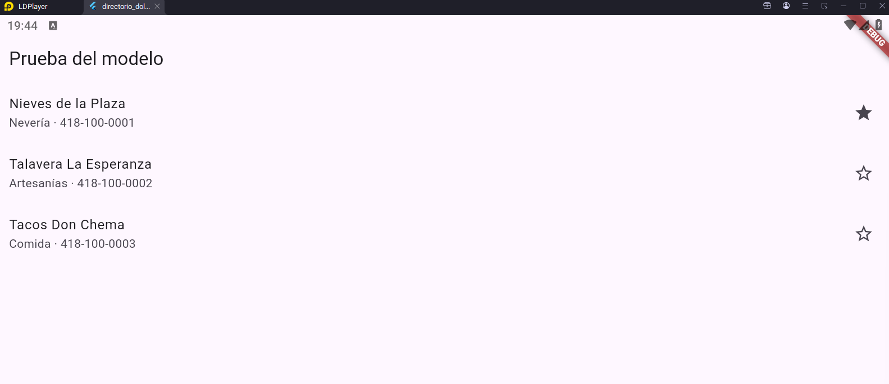
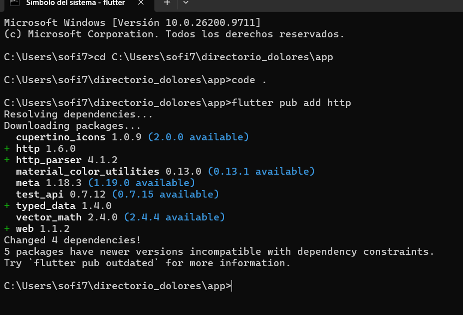
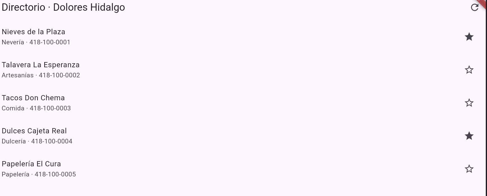
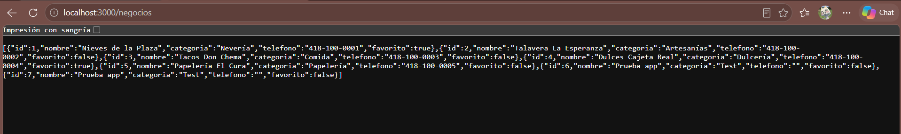
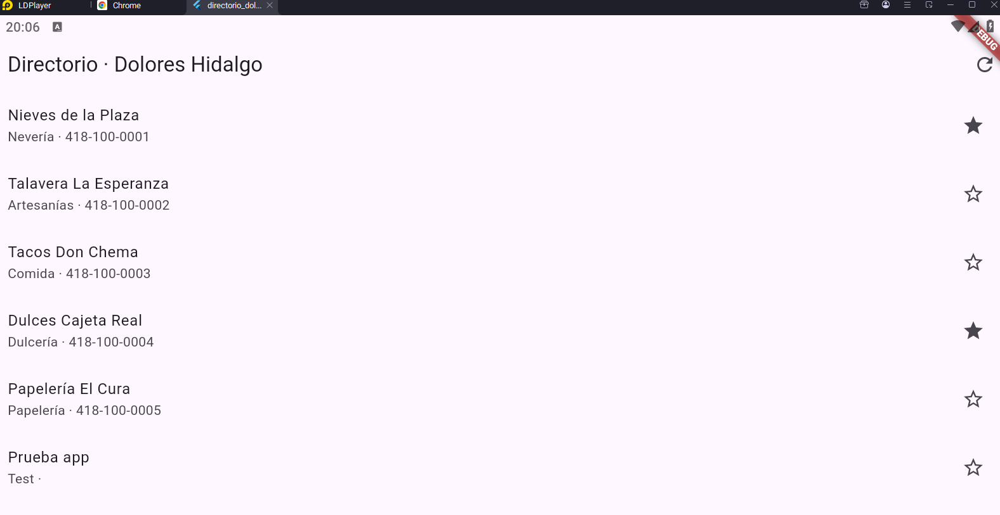
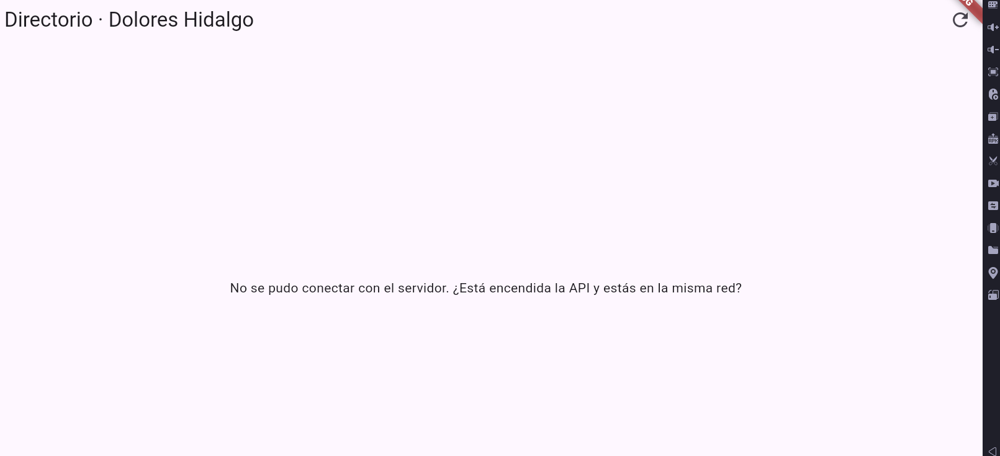
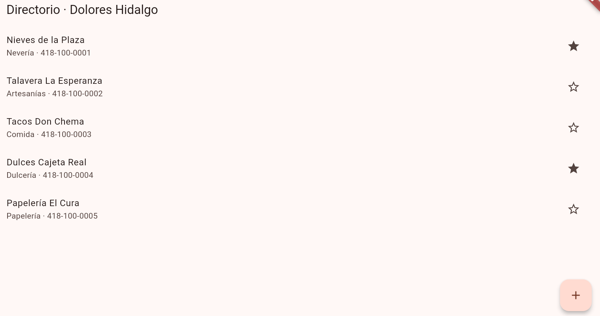

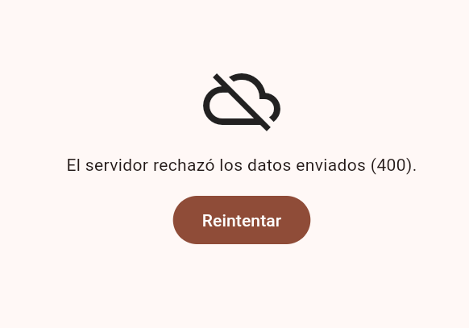
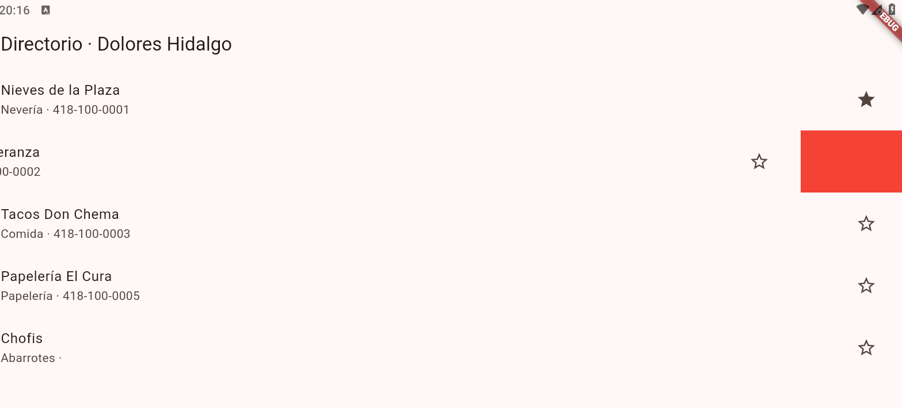
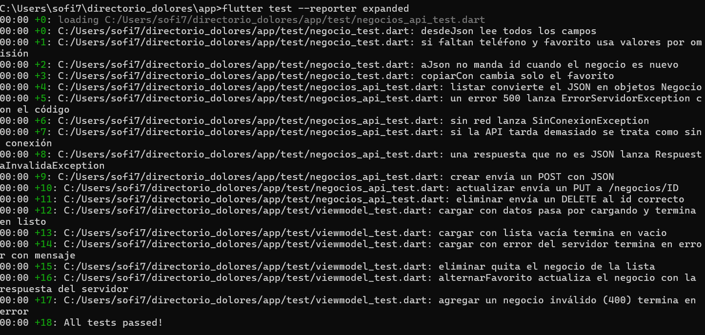

